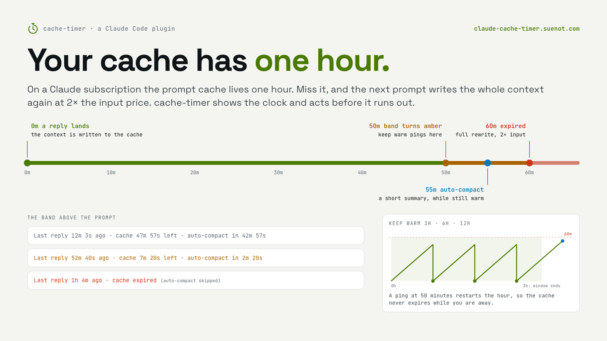

# claude-cache-timer

**Your prompt cache has one hour. This Claude Code plugin shows it and acts before it runs out.**

Site: https://claude-cache-timer.suenot.com

<picture>
  <source media="(prefers-color-scheme: dark)" srcset="docs/infographic-dark.png">
  
</picture>

## Why

On a Claude subscription, Claude Code keeps your conversation in the prompt cache for one hour after the last reply. While it is warm, every prompt reads the context at a tenth of the input price. Step away for longer (a meeting, lunch, a long build) and the cache expires without any sign: the next prompt writes the whole context again, at twice the input price. In a long session that is the most expensive prompt of the day.

## What it does

1. **Shows the hour.** A band above the prompt: `Last reply 12m 3s ago · cache 47m 57s left`. Dim while more than 10 minutes remain, amber under 10 minutes, red with `cache expired` after the hour.
2. **Compacts before it expires.** At 55 idle minutes it runs `/compact` while the cache is still warm, so your next prompt pays for a short summary instead of the whole context.
3. **Keeps the cache warm while you are away.** Press **Keep warm 3h**, **6h** or **12h**: a small ping when the cache is 50 minutes old restarts the hour.

## Install

At the prompt of a terminal session:

```
/plugin install cache-timer --marketplace suenot/claude-cache-timer
```

From a shell:

```
claude plugin install cache-timer --marketplace suenot/claude-cache-timer
```

In the desktop app, where `/plugin` does not run: click + next to the prompt box, then Plugins, Add marketplace with `suenot/claude-cache-timer`, then Add plugin.

Nothing to configure. With an API key or usage credits, Claude Code caches for 5 minutes instead of an hour: set Claude Code's `promptCacheTtl` to `1h`, or set `TTL_MS` in `hooks/register.tsx` to 5 minutes.

## Details

### The band

It refreshes every 15 seconds and counts from the last model response, so it resets on every reply of a running turn, not only when the turn ends. It works in the open chat only; it does not change the session list.

### Auto-compact (always on)

When the conversation sits idle and the cache reaches 55 minutes, the plugin runs `/compact` by itself (`$.session.compact`). The summary request reads the cached prefix cheaply. The band shows `auto-compact in Nm` until then and `Auto-compacted at HH:MM (Nk to Mk tokens)` afterwards, and the hour starts again from the summary request.

It runs once per idle period: after it, nothing more happens until you write again, so an abandoned session is compacted at most once and never hourly. It is skipped while a turn runs, while Keep warm is on (compaction resumes after the window ends), when the cache has already expired, and when the context is under 30k tokens. When a task is finished and the session will not be used again, press **Skip auto-compact** on the band to spend nothing on it. The skip lasts until your next message, and pressing **Auto-compact** undoes it. The thresholds are `COMPACT_AFTER_MS` and `MIN_COMPACT_TOKENS` in `hooks/register.tsx`.

### Keep warm

While it is on, the plugin sets a single timer for the moment the cache is 50 minutes old (no polling; the timer is reset after every turn). If no turn is running then, it sends one tool-less fork over the session transcript (`$.model.fork`), which reads the cached prefix and so restarts the 1-hour lifetime. The band then shows `keeping warm until HH:MM (N pings)` and the button becomes **Stop warming**.

Pings spend tokens: each one re-reads the whole context from the cache. A 3-hour window means 3 to 4 pings, 6 hours 7 to 8, 12 hours 14 to 15, depending on how long after a reply you press the button. Warming stops by itself when the window ends (then auto-compact takes over), when a ping finds the cache already cold (read is zero, or the write is 10% or more of the read), after 3 failed pings in a row, or after `/clear`. Windows are per session and are forgotten when Claude Code restarts. Pressing the button again stops warming.

The ping logic was written against the API types and checked by `claude plugin validate`; it has not been run for a full 50-minute cycle yet.

## License

MIT
